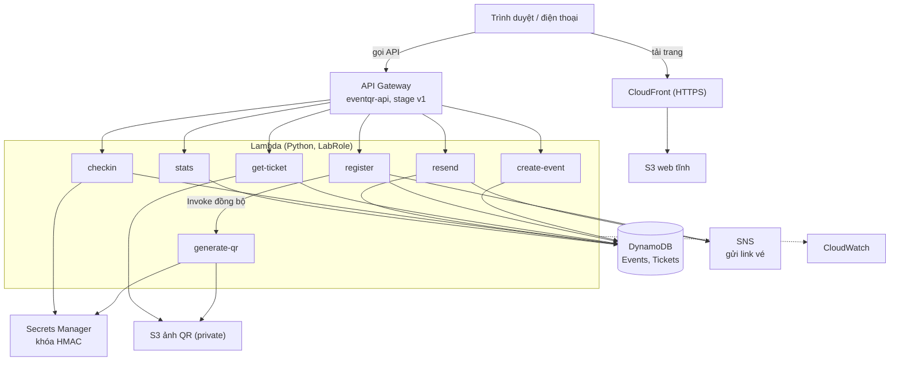

# EventQR — Hệ thống quản lý sự kiện và check-in bằng QR code

Đồ án môn **Cloud** (Đợt 1, 2026–2027) — nhóm **Domain Apps** — GVHD: Huỳnh Xuân Phụng.

EventQR cho phép người dùng đăng ký một sự kiện và nhận vé là một mã QR. Tại cổng, ban tổ chức quét QR bằng camera trên trang web; hệ thống xác minh vé thật bằng chữ ký HMAC và chỉ cho vào **một lần**. Ban tổ chức xem được thống kê số vé đã đăng ký và đã vào.

Toàn bộ hệ thống chạy trên **AWS Learner Lab** theo hướng serverless, Region `us-east-1`, dùng `LabRole` (không tạo IAM user hoặc role).

> **Trạng thái:** đang ở giai đoạn thiết kế, **chưa triển khai**. Kiến trúc và đặc tả API là hợp đồng để triển khai, không phải bằng chứng hệ thống đã chạy. Một số điểm kỹ thuật còn là giả định cần kiểm chứng trên Learner Lab (xem [Điểm chưa kiểm chứng](#điểm-chưa-kiểm-chứng)). Cập nhật mục [Tiến độ](#tiến-độ) khi có kết quả thật.

## Chức năng

- Tạo sự kiện (ban tổ chức).
- Đăng ký tham dự và phát hành vé QR; link vé luôn hiển thị ngay trên web, đồng thời gửi qua email (SNS).
- Xem lại vé và gửi lại link vé.
- Check-in bằng cách quét QR qua camera trình duyệt; chống làm giả (HMAC) và chống check-in trùng (cập nhật có điều kiện trong DynamoDB).
- Thống kê theo sự kiện: tổng vé, đã check-in, chưa check-in.

Phạm vi được giữ ở mức tối thiểu: một email có thể đăng ký nhiều vé, chưa có đăng nhập hay phân quyền người dùng, chưa chống đăng ký trùng email.

## Kiến trúc



| Dịch vụ AWS | Vai trò |
| --- | --- |
| CloudFront + S3 (web) | Phục vụ các trang web qua HTTPS (camera trình duyệt chỉ chạy trên HTTPS hoặc localhost) |
| API Gateway (REST API) | Cổng vào cho sáu route, CORS, API key và throttle |
| Lambda (Python) | Bảy hàm xử lý nghiệp vụ, dùng `LabRole` |
| DynamoDB | Bảng `eventqr-events`, `eventqr-tickets`; chống check-in trùng |
| S3 (ảnh QR) | Lưu ảnh PNG của QR, bucket private |
| Secrets Manager | Giữ khóa HMAC để ký và kiểm tra QR |
| SNS | Gửi link vé qua email, mỗi email một subscription có filter policy |
| CloudWatch | Log, một dashboard, vài alarm lỗi |

Luồng chi tiết, mô hình dữ liệu, bảo mật và các quyết định thiết kế nằm trong [`docs/architecture.md`](docs/architecture.md). Sơ đồ sequence: [đăng ký và gửi vé](docs/diagrams/sequence-register.png), [check-in](docs/diagrams/sequence-checkin.png).

### Cách QR hoạt động

Nội dung QR là `v1.<eventId>.<ticketId>.<signature>`, trong đó `signature` là HMAC-SHA256 của chuỗi `v1.<eventId>.<ticketId>` (base64url, không padding). QR không chứa tên hay email. Khi check-in, Lambda kiểm tra chữ ký bằng so sánh hằng thời gian, rồi cập nhật vé từ `ISSUED` sang `CHECKED_IN` bằng một thao tác có điều kiện; nếu hai thiết bị quét cùng lúc thì chỉ một bên thành công, bên còn lại nhận `409`.

## API

Base URL dự kiến: `https://<api-id>.execute-api.us-east-1.amazonaws.com/v1`.

| Route | Quyền | Chức năng |
| --- | --- | --- |
| `POST /events` | Ban tổ chức (`x-api-key`) | Tạo sự kiện |
| `POST /register` | Công khai | Đăng ký, phát hành vé QR, gửi link vé |
| `GET /ticket?e=&t=` | Người có link vé | Lấy ảnh QR của vé |
| `POST /resend` | Có `eventId` và `ticketId` | Gửi lại link vé qua email |
| `POST /checkin` | Ban tổ chức (`x-api-key`) | Check-in bằng QR |
| `GET /stats/{eventId}` | Ban tổ chức (`x-api-key`) | Thống kê vé của sự kiện |

Phản hồi thành công có dạng `{"ok": true, "data": {...}}`, lỗi có dạng `{"ok": false, "error": {"code", "message", "details"}}`. Đặc tả đầy đủ (request, mã lỗi, quy tắc xử lý, 21 tình huống nghiệm thu): [`docs/api.md`](docs/api.md).

## Cấu trúc repo

```
lambdas/              mỗi hàm một thư mục; lambdas/common/ cho mã dùng chung (ví dụ ticket_mail)
frontend/             trang đăng ký, vé, check-in, thống kê; config.js
docs/
  architecture.md     kiến trúc, luồng xử lý, dữ liệu, bảo mật, quyết định thiết kế
  api.md              đặc tả API
  naming.md           quy ước đặt tên và tag tài nguyên
  services.md         vai trò và cấu hình từng dịch vụ (sẽ bổ sung)
  diagrams/           sơ đồ dạng ảnh
  evidence/           ảnh minh chứng theo tuần (week1 ... week4)
  worklog/            nhật ký công việc hằng tuần
README.md
```

## Triển khai

Chưa có script triển khai. Dự kiến: làm tay trên AWS Console ở tuần 1–2 để hiểu từng dịch vụ, đóng gói SAM/CloudFormation ở tuần 3 nếu còn thời gian. Nếu không kịp, báo cáo sẽ ghi rõ là triển khai thủ công.

Quy tắc khi triển khai:

- Chỉ dùng Region `us-east-1`, Lambda dùng `LabRole`.
- Đặt tên và gắn tag theo [`docs/naming.md`](docs/naming.md): `Project=EventQR`, `Owner=<tên người tạo>`.
- Không hardcode Account ID hay ARN. Cấu hình qua biến môi trường: `EVENTS_TABLE`, `TICKETS_TABLE`, `SECRET_NAME`, `QR_BUCKET`, `SNS_TOPIC_ARN`, `WEB_BASE_URL`, `GENERATE_QR_FUNCTION`, `QR_DELIVERY_MODE`. Frontend đọc `API_BASE_URL` và `WEB_BASE_URL` từ `config.js`.
- Mỗi thành viên có tài khoản Learner Lab riêng; tài nguyên không chia sẻ giữa hai tài khoản nên hệ thống cuối được deploy từ Git vào tài khoản chính.
- Credentials của Learner Lab đổi mỗi lần Start Lab; nhớ cập nhật lại cho AWS CLI và Postman.


## Tiến độ

Kế hoạch 4 tuần, tính từ 05/10/2026.

| Tuần | Thời gian | Nội dung | Trạng thái |
| --- | --- | --- | --- |
| 1 | 05–11/10 | Tìm hiểu dịch vụ, thiết kế kiến trúc, vẽ sơ đồ, dựng nền tảng, gắn tag, năm bài thử rủi ro | Cập nhật tại đây |
| 2 | 12–18/10 | Triển khai chức năng lõi, kiểm thử từng thành phần | Chưa bắt đầu |
| 3 | 19–25/10 | Tích hợp, bảo mật, giám sát, IaC nếu kịp; đóng băng chức năng 25/10 | Chưa bắt đầu |
| 4 | 26/10–01/11 | Kiểm thử tổng thể, tối ưu chi phí, báo cáo, demo, dọn tài nguyên | Chưa bắt đầu |

## Nhóm thực hiện

| Thành viên | Phụ trách |
| --- | --- |
| _(Đặng Duy Quang, 24110307)_ — A | Vé và dữ liệu: `register`, `checkin`, `stats`, DynamoDB, Secrets Manager, ký và kiểm tra HMAC |
| _(Trương Hoàng Long, 24110273)_ — B | Gửi vé và giao diện: `create-event`, `generate-qr`, `get-ticket`, `resend`, S3, SNS, CloudFront, CloudWatch, các trang web |

Cả hai thành viên đều phải giải thích được toàn bộ cấu hình và mã nguồn khi vấn đáp.

## Hỗ trợ AI

Theo quy định của đề, phần có AI hỗ trợ được ghi rõ: các tài liệu kiến trúc, đặc tả API, quy ước đặt tên và README này được soạn với sự hỗ trợ của Claude (Anthropic); nhóm chịu trách nhiệm về nội dung. Chi tiết theo từng tuần nằm trong worklog.

## Tài liệu

- [Kiến trúc](docs/architecture.md)
- [Đặc tả API](docs/api.md)
- [Quy ước đặt tên và tag](docs/naming.md)
