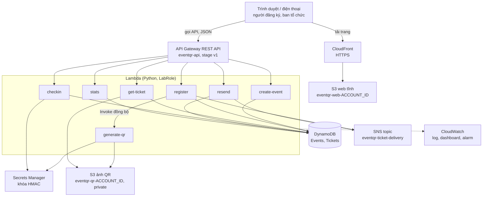
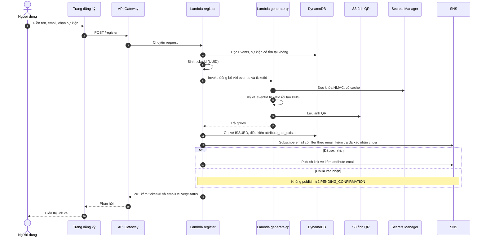
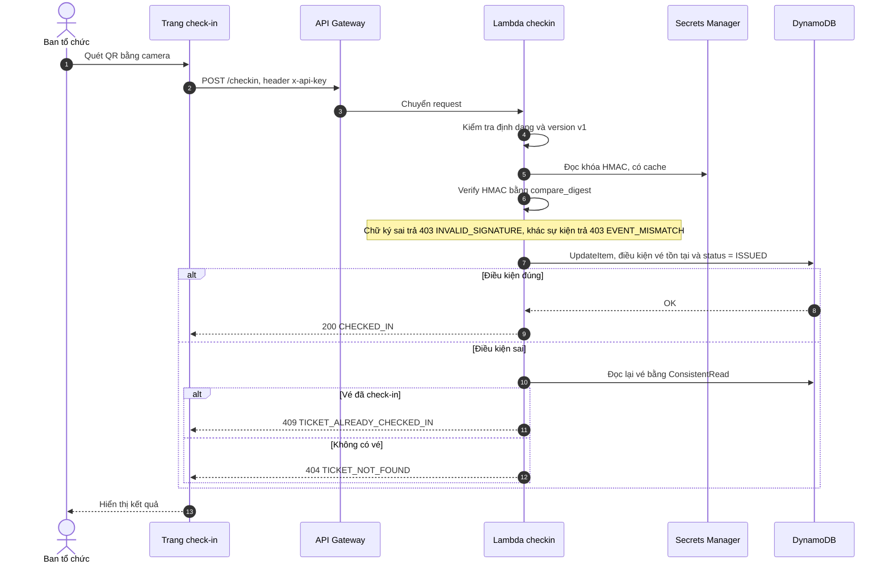

# Kiến trúc hệ thống — EventQR (v1, 11/10/2026)

> **Ghi chú 19/10:** tài liệu này lưu thiết kế v1. Source tuần 2 đã ghép theo phương án API Gateway → Lambda web → S3 private, với 8 Lambda tính cả web; sơ đồ CloudFront bên dưới là phương án trước đây. Trạng thái local và các mức bằng chứng AWS mới nhất nằm trong [báo cáo ghép mã](WEEK2-STATUS.md) và [README](../README.md#kiến-trúc). Không coi ghi nhận v1 là xác nhận deployment hiện tại.

Đề tài: Hệ thống quản lý sự kiện và check-in bằng QR code (nhóm Domain Apps, môn Cloud, GVHD Huỳnh Xuân Phụng).

Trạng thái: bản thiết kế v1, chưa triển khai. Một số điểm kỹ thuật còn là giả định cần kiểm chứng trên AWS Learner Lab (mục 9). Tài liệu được soạn với sự hỗ trợ của AI (Claude).

## 1. Mục tiêu và phạm vi

Người dùng đăng ký sự kiện và nhận vé là một mã QR. Tại cổng, ban tổ chức quét QR bằng camera trên trang web; hệ thống xác minh vé thật bằng chữ ký HMAC và chỉ cho vào một lần. Ban tổ chức xem thống kê số vé đã đăng ký và đã vào.

Phạm vi tối thiểu: một email có thể đăng ký nhiều vé; chưa có đăng nhập hay phân quyền người dùng; chưa chống đăng ký trùng email. Toàn bộ chạy trên AWS Learner Lab, Region `us-east-1`, dùng `LabRole` (không tạo IAM user hoặc role).

## 2. Tổng quan kiến trúc

Sáu route công khai ra ngoài qua API Gateway; `generate-qr` chỉ được gọi nội bộ từ `register`.

## 3. Thành phần và vai trò

| Dịch vụ | Vai trò trong hệ thống | Cấu hình chính |
| --- | --- | --- |
| CloudFront | Phục vụ các trang web qua HTTPS (camera trình duyệt chỉ chạy trên HTTPS hoặc localhost) | Origin là bucket web, Redirect HTTP to HTTPS, root object `index.html` |
| S3 `eventqr-web-<AccountID>` | Chứa trang đăng ký, trang vé, trang check-in, trang thống kê | Private, Block public access bật, truy cập qua CloudFront |
| S3 `eventqr-qr-<AccountID>` | Lưu ảnh PNG của QR, key `qr/<eventId>/<ticketId>.png` | Private, Block public access bật |
| API Gateway `eventqr-api` | Cổng vào cho sáu route, CORS, API key và usage plan cho route ban tổ chức, throttle | REST API, stage `v1` |
| Lambda (7 hàm, Python) | Xử lý nghiệp vụ: `create-event`, `register`, `generate-qr`, `get-ticket`, `resend`, `checkin`, `stats` | Execution role `LabRole`, cấu hình qua biến môi trường |
| DynamoDB `eventqr-events`, `eventqr-tickets` | Lưu sự kiện và vé; chống check-in trùng bằng conditional update | On-demand |
| Secrets Manager `eventqr-hmac-key` | Giữ khóa HMAC để ký và kiểm tra QR | JSON `{kid, key}`, đọc một lần rồi cache trong Lambda |
| SNS `eventqr-ticket-delivery` | Gửi link vé qua email; mỗi email là một subscription có filter policy theo địa chỉ | Topic Standard |
| CloudWatch | Log của Lambda, một dashboard, vài alarm lỗi | Đặt thời gian giữ log ngắn |

## 4. Luồng xử lý

### 4.1. Đăng ký và gửi vé

Thứ tự quan trọng: QR được lưu S3 trước, vé được ghi DynamoDB sau, email được gửi cuối cùng. Nhờ vậy không có vé nào thiếu QR, và link trong email mở được ngay khi người dùng nhận.

### 4.2. Nhận vé

Link vé (trên web hoặc trong email) là `https://<cloudfront>/ticket.html?e=<eventId>&t=<ticketId>`. Trang `ticket.html` gọi `GET /ticket`, Lambda `get-ticket` đọc vé và trả ảnh QR: URL S3 ký tạm thời mới mỗi lần mở (chế độ mặc định) hoặc ảnh base64 (chế độ dự phòng). Email không chứa URL ký cố định để tránh link hết hạn.

### 4.3. Check-in tại cổng

Chống trùng nằm ở DynamoDB, không nằm ở giao diện: hai thiết bị quét cùng một vé gần như đồng thời thì chỉ một request thỏa điều kiện `status = ISSUED`, request còn lại nhận 409.

### 4.4. Thống kê

Trang thống kê gọi `GET /stats/{eventId}` kèm API key. Lambda `stats` truy vấn các vé của sự kiện bằng `Query` theo `eventId` (đọc hết các trang), đếm theo `status` và trả tổng vé, số đã check-in, số chưa check-in.

## 5. Mô hình dữ liệu

**Bảng `eventqr-events`** (khóa phân vùng `eventId`)

| Thuộc tính | Kiểu | Ghi chú |
| --- | --- | --- |
| `eventId` | S | UUID do backend sinh |
| `name`, `venue` | S | Tên và địa điểm |
| `startTime` | S | ISO 8601 UTC |
| `createdAt` | S | ISO 8601 UTC |

**Bảng `eventqr-tickets`** (khóa phân vùng `eventId`, khóa sắp xếp `ticketId`)

| Thuộc tính | Kiểu | Ghi chú |
| --- | --- | --- |
| `eventId`, `ticketId` | S | `ticketId` là UUID ngẫu nhiên, khó đoán |
| `name`, `email` | S | Email chuẩn hóa chữ thường |
| `status` | S | `ISSUED` hoặc `CHECKED_IN` |
| `createdAt`, `checkedInAt` | S | ISO 8601 UTC; `checkedInAt` chỉ có sau khi check-in |
| `qrKey` | S | Đường dẫn ảnh QR trong S3 |
| `kid` | S | Phiên bản khóa HMAC đã dùng để ký |

Chọn khóa `eventId` + `ticketId` để lấy mọi vé của một sự kiện bằng `Query` (không cần chỉ mục phụ) và để check-in cập nhật đúng một item bằng khóa chính.

**Nội dung QR:** `v1.<eventId>.<ticketId>.<signature>`. `signature` là HMAC-SHA256 của chuỗi `v1.<eventId>.<ticketId>`, mã hóa base64url không padding. QR không chứa tên hay email. UUID không chứa dấu chấm nên không làm hỏng định dạng.

## 6. Bảo mật

| Vấn đề | Biện pháp | Hạn chế đã biết |
| --- | --- | --- |
| Làm giả vé | Chữ ký HMAC-SHA256; verify bằng `hmac.compare_digest`; khóa chỉ nằm trong Secrets Manager | Chưa xoay vòng khóa (QR `v1` không chứa `kid`) |
| Check-in trùng | Conditional update trong DynamoDB, đọc lại bằng `ConsistentRead` khi điều kiện thất bại | Không có |
| Truy cập của ban tổ chức | Header `x-api-key` kèm usage plan | Key nằm trong trình duyệt nên chỉ là mức bảo vệ tối thiểu, không phải đăng nhập |
| Truy cập vé | `ticketId` ngẫu nhiên; ảnh QR lấy qua `GET /ticket`; bucket ảnh private | Ai có link thì lấy được QR |
| Lạm dụng `/register` và `/resend` | Throttle ở stage, kiểm tra sự kiện tồn tại | Chưa có CAPTCHA hay xác thực; có thể bị dùng để gửi thư xác nhận SNS tới người lạ |
| Truyền tải | HTTPS qua CloudFront và API Gateway | Không có |
| Quyền Lambda | Dùng LabRole theo quy định của Learner Lab | Không áp dụng được quyền tối thiểu theo từng hàm |
| Lộ khóa | Không lưu khóa trong Git, log, ảnh chụp; `.gitignore` chặn file nhạy cảm | Phụ thuộc kỷ luật của nhóm |

## 7. Quyết định thiết kế và đánh đổi

| Quyết định | Lý do | Đánh đổi hoặc phương án khác |
| --- | --- | --- |
| Kiến trúc serverless (API Gateway, Lambda, DynamoDB) | Đề chỉ định dịch vụ; không quản lý server; gần như không tốn phí khi nhàn rỗi | Mỗi Lambda là một đơn vị nhỏ, cần thống nhất cấu hình và biến môi trường |
| Không đặt Lambda vào VPC | Lambda trong VPC mất đường ra SNS, Secrets Manager, DynamoDB nếu không có NAT Gateway hoặc VPC endpoint; NAT tính phí theo giờ | Không có lớp cách ly mạng; giải thích rõ trong báo cáo |
| DynamoDB On-demand, khóa `eventId` + `ticketId` | Không cần ước lượng dung lượng; `Query` theo sự kiện; conditional update chống trùng | Chưa hỗ trợ tìm vé theo email |
| Ký HMAC thay vì chỉ dùng mã ngẫu nhiên | Vé không làm giả được nếu không có khóa; từ chối vé giả trước khi chạm DB | Phụ thuộc bảo vệ khóa trong Secrets Manager |
| REST API thay vì HTTP API | Cần API key và usage plan cho route ban tổ chức | Cấu hình nhiều hơn; cần kiểm chứng trong Learner Lab |
| CloudFront đứng trước S3 | Có HTTPS cho camera; bucket web giữ private | Mất vài phút để deploy và cần invalidation khi sửa frontend; nếu OAC bị chặn thì dùng bucket website làm custom origin |
| Gửi vé qua SNS với filter policy theo email | Đề chỉ định SNS | Người nhận phải xác nhận subscription; bù bằng link vé trên web và route resend |
| Link vé là trang web, không phải presigned URL trong email | URL ký bằng credentials tạm có thể chết sớm | Cần thêm route `GET /ticket` và trang `ticket.html` |
| Tách `generate-qr` thành Lambda riêng, gọi đồng bộ | Khớp mô tả của đề; tách trách nhiệm ký và tạo ảnh | Thêm một lần `Invoke` trong luồng đăng ký |
| Thứ tự: sinh QR, ghi DB, rồi gửi email | Không có vé thiếu QR; link email luôn mở được | Lỗi sau khi ghi DB để lại ảnh QR mồ côi trong S3 (vô hại) |

## 8. Giám sát và chi phí

- CloudWatch: log của mọi Lambda với thời gian giữ ngắn (ví dụ 7 ngày), một dashboard `eventqr-dashboard`, alarm lỗi cho các hàm quan trọng (`register`, `checkin`).
- Chặn chi phí phát sinh: reserved concurrency thấp và timeout hợp lý cho Lambda, throttle ở stage, tránh S3 event kích hoạt lại chính Lambda ghi vào bucket đó.
- Ước tính thô của nhóm (chưa kiểm chứng với giá hiện hành): cả bốn tuần khoảng 1 đến 5 USD trong ngân sách 50 USD mỗi tài khoản; khoản đáng chú ý nhất là Secrets Manager và CloudWatch.

## 9. Điểm chưa kiểm chứng (v1)

| Điểm | Bài thử hoặc thời điểm kiểm chứng |
| --- | --- |
| Lambda dùng LabRole đọc được secret | Bài thử 1, tuần 1 |
| Ghi có điều kiện chặn ghi lần hai | Bài thử 2, tuần 1 |
| SNS filter hoạt động; cách nhận biết subscription pending hay đã xác nhận; kết quả khi Subscribe lại | Bài thử 3, tuần 1 |
| CloudFront và OAC dùng được; camera chạy trên điện thoại qua HTTPS | Bài thử 4, tuần 1 |
| Presigned URL sống đúng hạn qua lúc credentials hết hạn | Bài thử 5, tuần 1 |
| REST API, API key, usage plan, throttle, Gateway Responses tạo được trong Learner Lab | Tuần 2 |

Sơ đồ và mô tả sẽ được cập nhật sau các bài thử; mọi thay đổi ghi vào lịch sử phiên bản.

## 10. Đối chiếu với yêu cầu của đề

| Yêu cầu của đề | Nơi đáp ứng |
| --- | --- |
| API đăng ký | `POST /register` trên API Gateway, Lambda `register` |
| Lambda sinh QR, lưu S3, gửi link qua SNS email | `generate-qr` sinh và lưu ảnh; link vé gửi qua SNS sau khi vé được ghi (mục 4.1) |
| Trang check-in quét QR bằng camera web, gọi API | Trang check-in phục vụ qua CloudFront (HTTPS), gọi `POST /checkin` |
| DynamoDB chống check-in trùng | Conditional update trên bảng `eventqr-tickets` |
| Thống kê | `GET /stats/{eventId}`, Lambda `stats` |
| QR chứa mã ký HMAC, khóa trong Secrets Manager | Mục 5 và mục 6 |
| Dịch vụ: API Gateway, Lambda, DynamoDB, S3, SNS | Có đủ; bổ sung Secrets Manager (đề yêu cầu), CloudFront, CloudWatch |
| Region us-east-1, dùng LabRole, không tạo IAM | Toàn bộ hệ thống |
| Tag Project/Owner | Theo `naming.md` |
| CloudWatch, IaC nếu có | Mục 8; SAM/CloudFormation ở tuần 3 nếu kịp |

## Lịch sử phiên bản

| Phiên bản | Ngày | Thay đổi |
| --- | --- | --- |
| v1 | 11/10/2026 | Bản thiết kế đầu tiên: kiến trúc tổng quan, thành phần, luồng đăng ký và check-in, dữ liệu, bảo mật, quyết định thiết kế |
